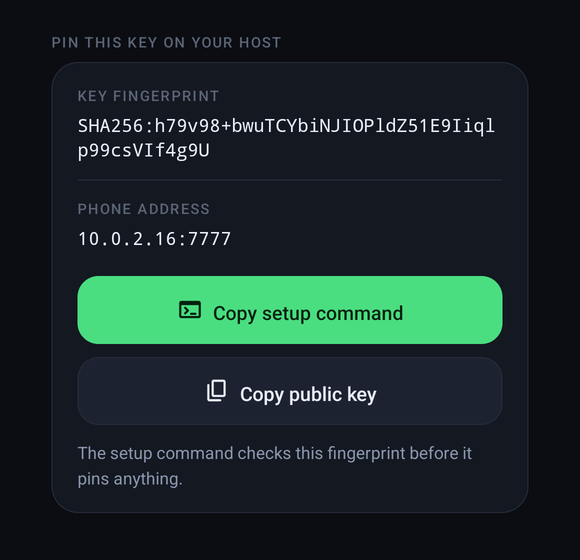

<p align="center">
  
</p>

<p align="center">
  <a href="LICENSE"></a>
  
  
  
  <a href="https://www.ritwickverma.dev/"></a>
  <a href="https://buycovfefefor.ritwickverma.dev/"></a>
</p>

# SudoStamp

**Approve `sudo` on your Linux machine by touching your Android phone's fingerprint sensor.**

Type `sudo`, your phone buzzes, you touch the sensor, the command runs. No password typed, nothing
in the cloud: the phone answers over your LAN, and the fingerprint is enforced by the phone's secure
hardware (TEE / StrongBox), not by app code. If anything goes wrong (phone off, out of range, you
tap Deny, 60 seconds pass) sudo simply falls back to your **ordinary password prompt**. It can make
sudo more convenient; it cannot lock you out.

## What it looks like

<table>
  <tr>
    <td align="center" width="33%"><br><sub><b>1. sudo on the host</b><br>The phone pops up who is asking. Deny works right from here.</sub></td>
    <td align="center" width="33%"><br><sub><b>2. Tap it</b><br>A countdown, the host and time, a warning for never-seen hosts. Then the system fingerprint prompt.</sub></td>
    <td align="center" width="33%"><br><sub><b>3. Touch the sensor</b><br>The TEE signs, sudo proceeds, the app closes itself.</sub></td>
  </tr>
  <tr>
    <td align="center"><br><sub><b>First run</b><br>Three steps and one button. Offers fingerprint enrollment if the phone has none.</sub></td>
    <td align="center"><br><sub><b>Setup</b><br>A live checklist: listener, notifications, battery, Do Not Disturb. "Ready" only when all pass.</sub></td>
    <td align="center"><br><sub><b>Denied or timed out</b><br>No signature leaves the phone; the host asks for the password.</sub></td>
  </tr>
</table>

<sub>Screenshots from a Pixel 7 emulator (hence <code>10.0.2.2</code>, the emulator's host). The
system fingerprint sheet that appears over step 2 is a secure window and does not show in
screenshots.</sub>

## How it works

```
sudo on the host
  -> PAM: pam_rssh (third-party) dials the phone over the LAN, as an ssh-agent
  -> phone: "Approve sudo? From 192.168.1.10"              (notification)
  -> tap -> BiometricPrompt -> fingerprint
  -> the phone's TEE signs pam_rssh's fresh 32-byte challenge
  -> pam_rssh verifies against the pinned public key -> sudo proceeds
```

## Why it can be trusted

- **The only custom code is the phone app, and it only signs.** PAM integration, signature
  verification and fail-closed behaviour are [`pam_rssh`](https://github.com/z4yx/pam_rssh)'s,
  an existing, maintained module. Nothing written here runs as root on the host at
  authentication time.
- **The biometric is a hardware gate.** The Android Keystore key is created with
  `setUserAuthenticationParameters(0, AUTH_BIOMETRIC_STRONG)`: a fresh strong biometric for
  *every* signature, enforced inside the TEE (or StrongBox). Malware on the phone cannot sign
  without your finger either, and the key cannot be exported.
- **It signs nothing but sudo challenges.** The agent refuses any payload that is not exactly
  pam_rssh's 32-byte challenge, so the key is useless as an SSH-login or git-signing oracle.
- **Zero third-party runtime dependencies** in the app: platform APIs only.

[SECURITY.md](SECURITY.md) has the full threat model, including what it does *not* protect
against. [docs/DESIGN.md](docs/DESIGN.md) has the design and the reasoning behind it.

## Requirements

- **Phone:** Android 11+ (API 30, where per-use biometric keys became expressible) with a
  Class 3 ("strong") fingerprint sensor.
- **Host:** any of the platforms below. The installer brings
  [`pam_rssh`](https://github.com/z4yx/pam_rssh) with it: a package where one exists, otherwise
  built from a pinned, verified commit.

  | Platform | Status |
  |---|---|
  | Arch, Manjaro, EndeavourOS | ✅ tested end to end in CI |
  | Debian 12 / 13, Ubuntu 24.04, Mint, Pop!_OS | ✅ tested end to end in CI |
  | Fedora, RHEL / Rocky / Alma 9 | ✅ tested end to end in CI |
  | openSUSE Tumbleweed | ✅ tested end to end in CI |
  | macOS 14+ (via `/etc/pam.d/sudo_local`) | 🧪 experimental, untested |
  | FreeBSD (`security/pam_rssh` port) | 🧪 experimental, untested |

  "Tested end to end" means every push runs [`tools/test/e2e.sh`](tools/test/e2e.sh) in a fresh
  container of that distribution: the installer, pam_rssh and a **real `sudo`**, against a mock
  phone. sudo must pass with no password while the phone approves, fall back to the password when
  it denies, and be restored byte for byte by rollback.
- Phone and host on the same LAN, with the phone at a stable address (a DHCP reservation).

## Setup

### 1. Phone

Use a signed APK from the project's Releases page once one is published (check it with the
`.sha256` file next to it), or build the debug APK yourself and install it (needs JDK 17 and an Android
SDK with platform 36 and build-tools 36.0.0 — `scripts/ci-setup-sdk.sh` installs a pinned one):

```sh
./gradlew assembleDebug
adb install -r app/build/outputs/apk/debug/app-debug.apk   # -r on later updates keeps the key
```

Open **SudoStamp**, allow notifications and tap **Create key** (it offers fingerprint enrollment
first if the phone has none). The setup screen is a checklist; fix whatever it flags — battery
optimization, so a sleeping phone answers instantly, and **Do Not Disturb**, which otherwise
delivers approvals silently with no pop-up (add SudoStamp to the apps it lets through; on Samsung
that is Settings → Notifications → Do not disturb → Apps). When it says **Ready** it also shows the address to
dial and the key's `SHA256:` fingerprint, and **Copy setup command** gives you the `install.sh
stage` line below, pre-filled with both. The listener restarts by itself after a reboot or an app update.

<p align="center"></p>

### 2. Host

Paste the phone's **Copy setup command** into a terminal in a checkout of this repo, or type it:

```sh
export SUDOSTAMP_PHONE=192.168.1.50:7777          # the phone address from the setup screen
sudo -E tools/install.sh stage     # check the key's fingerprint, install pam_rssh, pin the key
sudo -E tools/install.sh test      # approve once on a scratch PAM service; sudo untouched
sudo -E tools/install.sh apply     # add the SudoStamp block to sudo's PAM stack
```

- **`stage`** fetches the phone's key and pins it **only after its fingerprint matches the phone
  screen** (you confirm, or the pasted command carries it). The key arrives over plain TCP, so this
  comparison is what stops an impostor on the LAN from pinning its own key. It then installs
  pam_rssh: from the AUR (Arch, with `yay`/`paru`), the ports tree (FreeBSD), or built from source
  at a pinned commit. If the distribution's Rust is too old to build it (Debian 13, Ubuntu 24.04),
  it offers a temporary toolchain via the official rustup, deleted after the build.
- **`test`** writes a throwaway PAM service containing only the phone, and authenticates against it
  (`tools/pam_check.py`, no pamtester needed). Approve on the phone; nothing about sudo changes.
- **`apply`** backs up sudo's PAM file and inserts a clearly marked block above its first auth
  rule, atomically. Everything already there, including the password, stays as it was. Keep a root
  shell open, then check in a second terminal: `sudo -k && sudo true`.
- **`rollback`** removes exactly that block (or, on openSUSE, the override file it created).
  **`status`** shows what is in place.

**openSUSE** (and anywhere sudoers sets `Defaults targetpw` or `rootpw`): sudo there asks for
*root's* password, not yours, so the phone is never consulted. `stage` detects this and prints the
one-line sudoers override that makes sudo authenticate you instead. It never edits sudoers itself.

If the host has its own fingerprint reader (`pam_fprintd`), the block also tries it first when you
are at the desk, and goes straight to the phone when the sudo came in over SSH or Mosh
(`tools/sudostamp-is-local.sh`).

### By hand

Anywhere else, or if you prefer: pin the key yourself (root-owned directory **and** file —
pam_rssh does no ownership checks), then add one line **above** the first `auth` line of
`/etc/pam.d/sudo` (macOS: `/etc/pam.d/sudo_local`, with the module's full path):

```
# /etc/authorized_keys/<user>.keys  <- the line from the app's "Copy public key"
auth  sufficient  pam_rssh.so ssh_agent_addr=192.168.1.50:7777 auth_key_file=/etc/authorized_keys/${user}.keys cue
```

Set `ssh_agent_addr` explicitly (unset, pam_rssh falls back to `$SSH_AUTH_SOCK`, which the user
controls), and never put a space inside an argument (PAM splits on whitespace). The header of
`tools/install.sh` explains each argument.

## Day to day

A sudo posts an **Approve sudo** notification naming the requesting host. Tap it and touch the
sensor; the app shows *Approved* and closes. **Deny** works from the notification without opening
anything. A request from a host you have never approved before is flagged on the approval screen —
if you did not just run sudo, deny it. Unanswered requests are denied after 60 seconds.

## Development

```sh
./gradlew testDebugUnitTest                       # JVM unit tests
python3 tools/verify_ssh_sig.py app/build/sshcheck  # the test's SSH blobs, checked by OpenSSH + `cryptography`
./gradlew lintDebug assembleDebug
tools/verify.sh                                   # all of the above as four gates
```

Against a real phone (no finger needed, then one approval):

```sh
SUDOSTAMP_PHONE=<ip>:7777 python3 tools/reuse_connection_test.py --slow   # protocol + hardening probes
SUDOSTAMP_PHONE=<ip>:7777 python3 tools/simulate_pam_rssh.py              # pam_rssh's exact sequence
```

GitLab CI runs unit tests plus the independent signature check, lint, a debug build, and a hygiene
job (secret scan, shellcheck). [CONTRIBUTING.md](CONTRIBUTING.md) has the conventions;
[AGENTS.md](AGENTS.md) the commands, pitfalls and deliberate choices.

## Known limits

- **The prompt cannot say which command is being authorised.** pam_rssh sends only an opaque
  challenge; the host address and time are all that is knowable on the phone.
- **Anyone on the LAN can make the phone ask.** They cannot approve; they can annoy, and they can
  time a request to coincide with yours. The host shown and the first-host warning are there for
  this. See [SECURITY.md](SECURITY.md).
- Android may still kill the foreground service under extreme memory pressure; sudo then falls
  back to the password until the app is reopened.

## Credits

[`pam_rssh`](https://github.com/z4yx/pam_rssh) (MIT) does all of the host-side work. The
fingerprint glyph is Google's [Material Symbols](https://github.com/google/material-design-icons)
"fingerprint" (Apache-2.0) — see [NOTICE](NOTICE).

## License

MIT — see [LICENSE](LICENSE).
