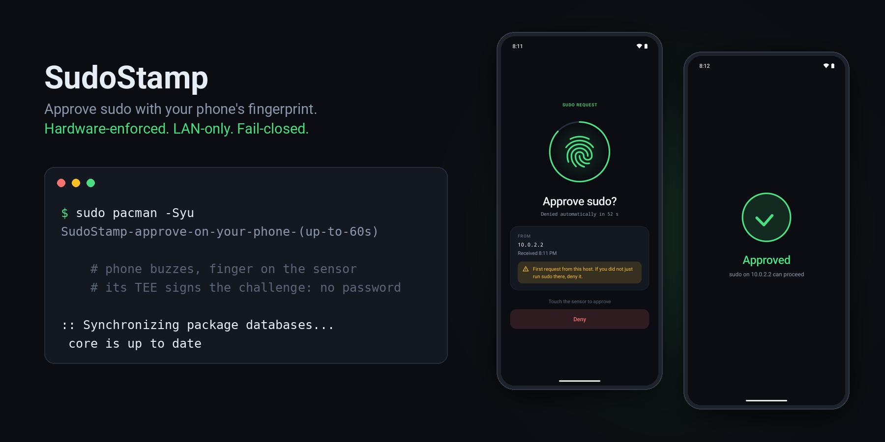
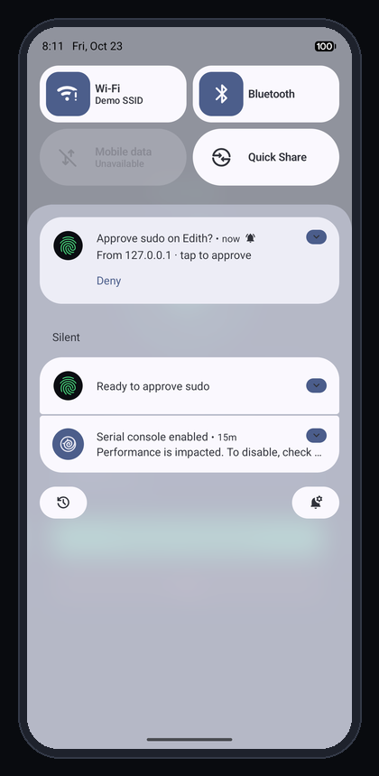
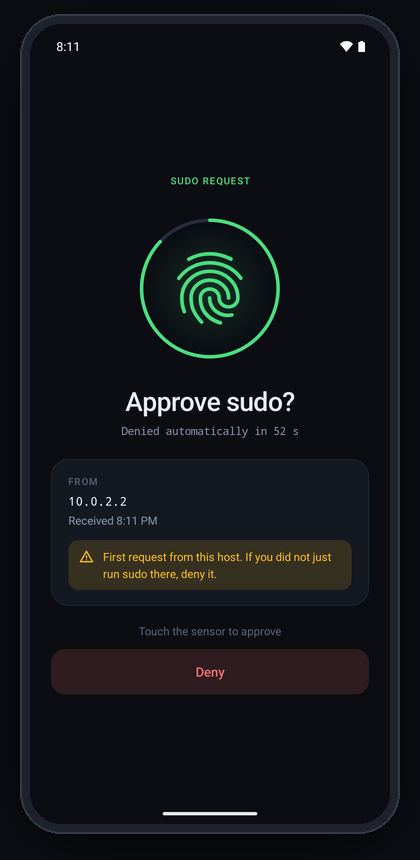
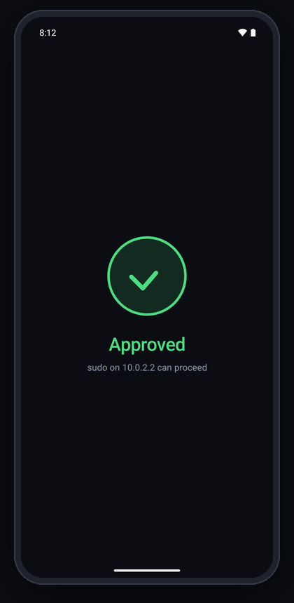
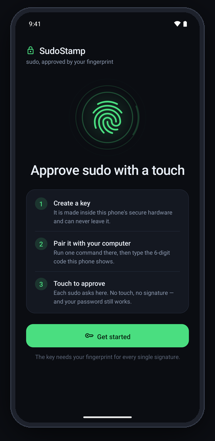
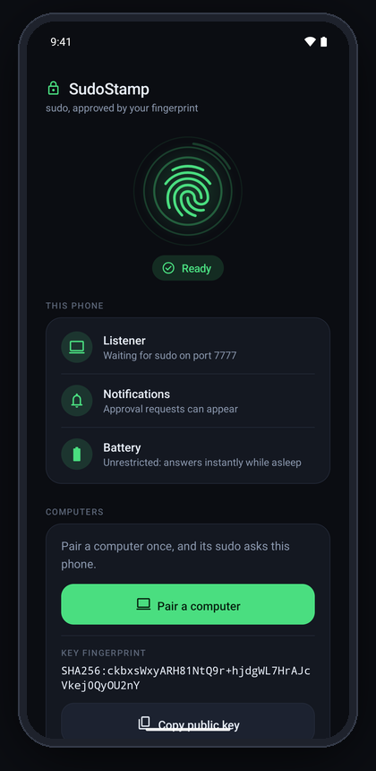
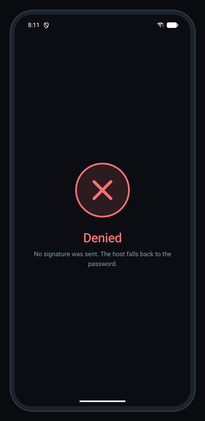
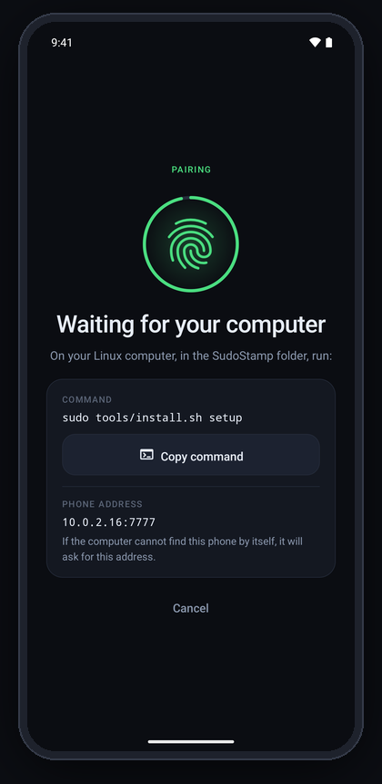
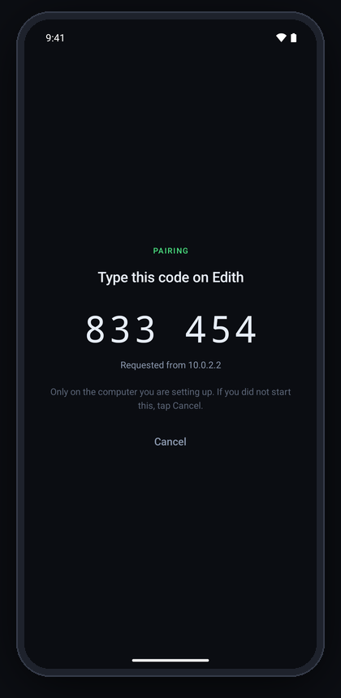

<p align="center">
  
</p>

<p align="center">
  <a href="https://gitlab.com/ritwick7/sudostamp/-/pipelines"></a>
  <a href="LICENSE"></a>
  
  
  
  
  <a href="https://www.ritwickverma.dev/"></a>
  <a href="https://buycovfefefor.ritwickverma.dev/"></a>
</p>

# SudoStamp

**Approve `sudo` on your Linux machine by touching your Android phone's fingerprint sensor.**

Type `sudo`, your phone buzzes, you touch the sensor, the command runs. No password typed, nothing
in the cloud: the phone answers over your LAN, and the fingerprint is enforced by the phone's secure
hardware (TEE / StrongBox), not by app code. If anything goes wrong (phone off, out of range, you
tap Deny, 60 seconds pass) sudo simply falls back to your **ordinary password prompt**. It can make
sudo more convenient; it cannot lock you out.

## What it looks like

<table>
  <tr>
    <td align="center" width="33%"><br><sub><b>1. sudo on the host</b><br>The phone pops up who is asking. Deny works right from here.</sub></td>
    <td align="center" width="33%"><br><sub><b>2. Tap it</b><br>A countdown, the host and time, a warning for never-seen hosts. Then the system fingerprint prompt.</sub></td>
    <td align="center" width="33%"><br><sub><b>3. Touch the sensor</b><br>The TEE signs, sudo proceeds, the app closes itself.</sub></td>
  </tr>
  <tr>
    <td align="center"><br><sub><b>First run</b><br>Three steps and one button. Offers fingerprint enrollment if the phone has none.</sub></td>
    <td align="center"><br><sub><b>Setup</b><br>A live checklist: listener, notifications, battery, Do Not Disturb. "Ready" only when all pass.</sub></td>
    <td align="center"><br><sub><b>Denied or timed out</b><br>No signature leaves the phone; the host asks for the password.</sub></td>
  </tr>
</table>

<sub>Screenshots from a Pixel 7 emulator (hence <code>10.0.2.2</code>, the emulator's host). The
system fingerprint sheet that appears over step 2 is a secure window and does not show in
screenshots.</sub>

## How it works

```
sudo on the host
  -> PAM: pam_rssh (third-party) dials the phone over the LAN, as an ssh-agent
  -> phone: "Approve sudo? From 192.168.1.10"              (notification)
  -> tap -> BiometricPrompt -> fingerprint
  -> the phone's TEE signs pam_rssh's fresh 32-byte challenge
  -> pam_rssh verifies against the pinned public key -> sudo proceeds
```

## Why it can be trusted

- **The only custom code is the phone app, and it only signs.** PAM integration, signature
  verification and fail-closed behaviour are [`pam_rssh`](https://github.com/z4yx/pam_rssh)'s,
  an existing, maintained module. Nothing written here runs as root on the host at
  authentication time.
- **The biometric is a hardware gate.** The Android Keystore key is created with
  `setUserAuthenticationParameters(0, AUTH_BIOMETRIC_STRONG)`: a fresh strong biometric for
  *every* signature, enforced inside the TEE (or StrongBox). Malware on the phone cannot sign
  without your finger either, and the key cannot be exported.
- **It signs nothing but sudo challenges.** The agent refuses any payload that is not exactly
  pam_rssh's 32-byte challenge, so the key is useless as an SSH-login or git-signing oracle.
- **Zero third-party runtime dependencies** in the app: platform APIs only.

[SECURITY.md](SECURITY.md) has the full threat model, including what it does *not* protect
against. [docs/DESIGN.md](docs/DESIGN.md) has the design and the reasoning behind it.

## Requirements

- **Phone:** Android 11+ (API 30, where per-use biometric keys became expressible) with a
  Class 3 ("strong") fingerprint sensor.
- **Host:** any of the platforms below. The installer brings
  [`pam_rssh`](https://github.com/z4yx/pam_rssh) with it: a package where one exists, otherwise
  built from a pinned, verified commit.

  | Platform | Status |
  |---|---|
  | Arch, Manjaro, EndeavourOS | ✅ tested end to end in CI |
  | Debian 12 / 13, Ubuntu 24.04, Mint, Pop!_OS | ✅ tested end to end in CI |
  | Fedora, RHEL / Rocky / Alma 9 | ✅ tested end to end in CI |
  | openSUSE Tumbleweed | ✅ tested end to end in CI |
  | Windows, via WSL (any distribution above) | 🧪 should work, untested; discovery may not see the phone across WSL2's NAT, so pass `--phone` |
  | macOS 14+ (via `/etc/pam.d/sudo_local`) | 🧪 experimental, untested |
  | FreeBSD (`security/pam_rssh` port) | 🧪 experimental, untested |

  "Tested end to end" means every push runs [`tools/test/e2e.sh`](tools/test/e2e.sh) in a fresh
  container of that distribution: the installer, pam_rssh and a **real `sudo`**, against a mock
  phone. sudo must pass with no password while the phone approves, fall back to the password when
  it denies, and be restored byte for byte by rollback.
- Phone and host on the same LAN, with the phone at a stable address (a DHCP reservation).

## Setup

**1. Phone.** Install the app: a signed APK from the project's Releases page once one is published
(check it with the `.sha256` beside it), or build it yourself (JDK 17, Android SDK 36,
`./gradlew assembleDebug`, then `adb install -r app/build/outputs/apk/debug/app-debug.apk`).
Open it and tap **Get started**: the key is created inside the phone's secure hardware and the
phone starts waiting for your computer.

**2. Computer.** In a checkout of this repository:

```sh
sudo tools/install.sh setup
```

That is the whole setup. It finds the phone on your network, and the phone shows a 6-digit code:

<table>
  <tr>
    <td align="center" width="33%"></td>
    <td align="center" width="33%"></td>
    <td align="center" width="33%"></td>
  </tr>
</table>

Type the code into the terminal, approve one test request with your finger, and it is done:

```
1/4  Pairing with the phone at 192.168.1.50:7777
  Your phone now shows a 6-digit code.
  Code on the phone: 833454
  Codes match: paired.
2/4  Installing pam_rssh
3/4  Testing, without touching sudo yet
  Approve the request on your phone now
4/4  Turning it on for sudo
  OK   Done. Every sudo now asks your phone first; your password still works as before.
```

What `setup` does, step by step:

- **Pairs** using the code (below: why a code, and why it is safe). Nothing is installed or changed
  until the codes match, and a wrong code changes nothing at all.
- **Installs pam_rssh**: from the AUR (Arch, with `yay`/`paru`), the ports tree (FreeBSD), or
  built from a pinned, verified commit. If the distribution's Rust is too old to build it (Debian
  13, Ubuntu 24.04) it offers a temporary toolchain from the official rustup, deleted afterwards.
- **Tests** on a throwaway PAM service that only the phone can satisfy. sudo is not touched yet.
- **Turns it on**: backs up sudo's PAM file and inserts one clearly marked block above its first
  auth rule, atomically. Everything already there, including the password, stays as it was.
  Re-running `setup` (a new phone, a reset key) replaces the block rather than adding a second.
  An older SudoStamp install that replaced the whole file is migrated, after asking.

`sudo tools/install.sh rollback` takes the block out again; `tools/install.sh status` shows what is
in place. If discovery cannot find the phone (some networks block it), `setup` asks for the address
the phone shows, or pass it: `setup --phone 192.168.1.50:7777`.

If the computer has its own fingerprint reader (`pam_fprintd`), the block also tries it first when
you are at the desk, and goes straight to the phone when the sudo came in over SSH or Mosh
(`tools/sudostamp-is-local.sh`).

**openSUSE** (and anywhere sudoers sets `Defaults targetpw` or `rootpw`): sudo there asks for
*root's* password, not yours, so the phone is never consulted. `setup` detects this and prints the
one-line sudoers override that makes sudo authenticate you instead. It never edits sudoers itself.

### Why a 6-digit code

The computer has to learn the phone's key over the network, and anything that can answer at the
phone's address could offer its own key instead. Comparing a long fingerprint by eye stops that in
theory and rarely in practice; a short code is easy to check, but a naive one can be forged.

So pairing works like Bluetooth's: the phone **commits** to its key before it sees the computer's
random number, and both then derive the code. Someone in the middle cannot steer either side's
code, so their only chance is a one-in-a-million guess, and the phone allows **one** attempt per
tap of *Pair a computer*: a second attempt during a pairing stops it, with a warning on screen.
You *type* the code, so it really gets compared. The protocol is documented in
[`Pairing.kt`](app/src/main/java/com/ritwick/sudostamp/Pairing.kt) and tested in CI with a
simulated man in the middle on every supported distribution.

For scripts: `stage --fingerprint SHA256:…` (the full fingerprint the app shows) or
`stage --key "ecdsa-sha2-nistp256 AAAA…"` (pasted from **Copy public key**, no network at all).

### By hand

Anywhere else, or if you prefer: pin the key yourself (root-owned directory **and** file —
pam_rssh does no ownership checks), then add one line **above** the first `auth` line of
`/etc/pam.d/sudo` (macOS: `/etc/pam.d/sudo_local`, with the module's full path):

```
# /etc/authorized_keys/<user>.keys  <- the line from the app's "Copy public key"
auth  sufficient  pam_rssh.so ssh_agent_addr=192.168.1.50:7777 auth_key_file=/etc/authorized_keys/${user}.keys cue
```

Set `ssh_agent_addr` explicitly (unset, pam_rssh falls back to `$SSH_AUTH_SOCK`, which the user
controls), and never put a space inside an argument (PAM splits on whitespace).

**Only put this line in `sudo` (or another service whose user is already logged in), never in
`sshd`, `login` or a display manager.** There the user name is whatever the person at the prompt
typed, before any authentication, and `${user}` goes straight into a file path: a name like
`../../home/mallory/x` would point pam_rssh at a key file they wrote. The header of
`tools/install.sh` explains each argument.

## Day to day

A sudo posts an **Approve sudo** notification naming the requesting host. Tap it and touch the
sensor; the app shows *Approved* and closes. **Deny** works from the notification without opening
anything. A request from a host you have never approved before is flagged on the approval screen —
if you did not just run sudo, deny it. Unanswered requests are denied after 60 seconds.

## Development

```sh
./gradlew testDebugUnitTest                       # JVM unit tests
python3 tools/verify_ssh_sig.py app/build/sshcheck  # the test's SSH blobs, checked by OpenSSH + `cryptography`
./gradlew lintDebug assembleDebug
tools/verify.sh                                   # all of the above as four gates
```

Against a real phone (no finger needed, then one approval):

```sh
SUDOSTAMP_PHONE=<ip>:7777 python3 tools/reuse_connection_test.py --slow   # protocol + hardening probes
SUDOSTAMP_PHONE=<ip>:7777 python3 tools/simulate_pam_rssh.py              # pam_rssh's exact sequence
```

GitLab CI runs unit tests plus the independent signature check, lint, a debug build, and a hygiene
job (secret scan, shellcheck). [CONTRIBUTING.md](CONTRIBUTING.md) has the conventions;
[AGENTS.md](AGENTS.md) the commands, pitfalls and deliberate choices.

## Known limits

- **The prompt cannot say which command is being authorised.** pam_rssh sends only an opaque
  challenge; the host address and time are all that is knowable on the phone.
- **Anyone on the LAN can make the phone ask.** They cannot approve; they can annoy, and they can
  time a request to coincide with yours. The host shown and the first-host warning are there for
  this. See [SECURITY.md](SECURITY.md).
- Android may still kill the foreground service under extreme memory pressure; sudo then falls
  back to the password until the app is reopened.

## Credits

[`pam_rssh`](https://github.com/z4yx/pam_rssh) (MIT) does all of the host-side work. The
fingerprint glyph is Google's [Material Symbols](https://github.com/google/material-design-icons)
"fingerprint" (Apache-2.0) — see [NOTICE](NOTICE).

## License

MIT — see [LICENSE](LICENSE).
